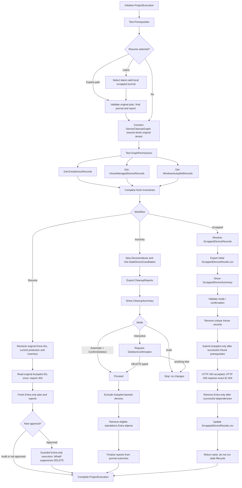

# Architecture

## Overview

`Invoke-StaleDeviceCleanup.ps1` is a thin orchestration script that imports
`StaleDeviceCleanup.psm1` and selects one of four mutually exclusive entry
parameter sets. Resume is a separate operator-selected flow, not an automatic
continuation of an ordinary run:

## Module layout

`src\StaleDeviceCleanup.psm1` contains the core regions and dot-sources
`DeviceDeletionBatch.ps1` (execution) and `DeviceCleanupResume.ps1` (resume).
Import `StaleDeviceCleanup.psd1`, not individual implementation files.

| Region | Responsibility |
| --- | --- |
| Logging | `Write-CleanupLog` – structured, timestamped, never logs secrets |
| Prerequisites and connection | Module checks, `Connect-MgGraph` wrapper, scope validation |
| Retry logic | `Invoke-GraphWithRetry` – bounded, exponential backoff, honors `Retry-After` |
| Discovery | `Get-EntraDeviceRecords`, `Get-IntuneManagedDeviceRecords`, `Get-WindowsAutopilotRecords` – one paginated call each, never per-device |
| Normalization helpers | `ConvertTo-NormalizedSerialNumber`, `Get-SafeUtcTimestamp`, `Resolve-DevicePlatform` |
| Indexing and correlation | `New-DeviceIndexes`, `Resolve-DeviceCorrelation` |
| Activity evaluation | `Get-EffectiveLastActivity` |
| Protection | `New-DeviceProtectionIndex`, `Test-DeviceProtection` - reuse case-insensitive ID/serial/name lookups and preserve wildcard rules |
| Evaluation orchestration | `Get-StaleDeviceCandidates` – produces one evaluated record per Entra device |
| Summary and confirmation | `Show-CleanupSummary`, `Show-ScrappedDeviceSummary`, `Request-DeletionConfirmation` |
| Reporting | `Export-CleanupReports`, `New-RunSummary`, `Set-ScrappedDeviceOutcomes` |
| Lifecycle state | Legacy report fields only; direct deletion no longer uses a retention ledger |
| Scrapped device cleanup | `Get-ScrappedDeviceSerialNumbers`, `Resolve-ScrappedDeviceRecords` – correlate `-ScrappedDevices` CSV serials against already-discovered Entra/Intune/Autopilot data, no extra Graph calls during resolution |
| Deletion planning and execution | `New-DeviceDeletionPlan` and `Invoke-DeviceDeletionPlan` – approval-bound plans, guarded phased batching, per-ID parsing/retries, journal and optional verification |
| Result mapping and context | `Set-DeviceDeletionResults`, `Assert-DeviceCleanupContext`, `Test-DeviceDeletionOutcome` |
| Resume source selection | `Get-LatestDeviceCleanupResumeSource` - local immediate-subfolder search, plan-time ordering and tenant/timestamp ambiguity checks |
| Resume source integrity | `Read-DeviceCleanupResumeSource` - validates plan hash, final journal and report operations/dependencies |
| Resume eligibility | `Resolve-DeviceCleanupResumeRecords` - current inventory/protection and cached exact-ID Autopilot GETs; emits Entra-only targets |
| Execution lifecycle | `Initialize-ProjectExecution`, `Complete-ProjectExecution` |

Discovery, correlation, evaluation, reporting, confirmation, and deletion are
implemented as separate functions so each stage can be unit tested in
isolation with mocked Graph cmdlets.

Autopilot removal uses the supported identity DELETE endpoint. A successful
response acknowledges the deletion request; it does not guarantee that the
record has already disappeared from the portal.

## Data flow

1. Discovery retrieves the complete Entra, Intune, and Autopilot data sets in
   three paginated Graph calls (`-All`).
2. `New-DeviceIndexes` builds hash tables keyed by normalized identifiers so
   correlation is O(1) per device instead of one Graph request per device.
3. `Get-StaleDeviceCandidates` iterates the Entra device list once, producing
   an `AllEvaluatedDevices` collection with a `Decision` of `Candidate`,
   `Excluded`, or `ManualReview`, plus a machine-readable `ReasonCode`.
4. Reports are written before any confirmation prompt is shown. Direct Entra
   removal does not depend on lifecycle state or a disabled retention period.
5. If the `-ScrappedDevices` workflow is enabled, `Resolve-ScrappedDeviceRecords`
   correlates CSV serials against already-discovered Entra/Intune/Autopilot
   sets without extra Graph calls. Multiple records require corroborating stable
   relationships; serial-only duplicates fail closed. Protection, platform,
   synchronization and conflicting-ID exclusions remain effective. The initial
   report and exact unique-object summary are produced
   before mode validation or an interactive confirmation prompt. After
   confirmation, unique Intune records are removed first, then each unique
   Autopilot identity is submitted through the identity DELETE endpoint. A
   failed Intune prerequisite blocks related Autopilot deregistration.
   A documented Autopilot HTTP 204 permits related Entra deletion as an
   accepted submission. An unexpected HTTP 200 requires immediate bounded
   exact-ID read-back (up to three GETs, five seconds apart); only verified
   absence permits the dependent Entra deletion. Unresolved dependencies block those Entra targets, while
   independent targets continue. This branch then exits early
   and never enters the standard stale lifecycle.
   `-ResumeFromRunPath` is a separate entrypoint to this explicit retirement
   branch: it validates the original approved plan, final journal and report,
   uses original Entra object IDs, reloads current inventories/protection, and
   verifies original Autopilot IDs once read-only. It creates a fresh Entra-only
   plan requiring new approval, never replays Intune/Autopilot DELETEs, and never
   modifies the source run. Current management, serial re-registration,
   identifier changes, protection and unresolved prerequisites fail closed.
6. The stale branch excludes Autopilot-backed records and removes only
   eligible standalone Entra objects after approval.
7. The approved target set is executed only through Microsoft Graph JSON
   batching, in independent envelopes of at most 20 operations. Phased
   dependencies, per-target `ShouldProcess`, tenant checks and journal
   checkpointing apply to every destructive run.
   [BatchDeletion.md](BatchDeletion.md) describes failure and verification semantics.

The entry point uses Inactivity (default), Scrapped, Resume and ResumeLatest
parameter sets. Only Inactivity binds DaysInactive or calculates a cutoff.
ResumeLatest selects by original plan creation time from validated sources,
not folder modification time. It does not combine sources or consult a
cross-run completion ledger. Both resume sets reuse the Scrapped plan/report
schema, with source-linkage fields rather than a new plan workflow value.
Strict scrapped CSV
validation occurs before discovery; incomplete discovery blocks all writes and
is reported as LookupFailed, never a trustworthy NotFound. Scrapped summaries
identify their workflow even for empty input and omit inactivity metadata.

## Preparation and execution cost

Inventory lookup and protection sets are built once per resolution instead
of repeatedly scanning/normalizing all records. Action reporting indexes rows
by resource/object ID while retaining repeated matches. Batch iteration uses
an offset, avoiding repeated front-removal of the remaining list. Unchanged
Audit reports are not exported again during finalization; execution still
recovers journal outcomes before writing final reports.

ResumeLatest validates local artifacts for journal-bearing subfolders;
large output histories can therefore add local I/O. Resume then reloads all
three service inventories and performs at most one explicit verifier call
per distinct original Autopilot dependency that reaches the verification
gate (cached for shared dependencies). It does not batch or parallelize
these GETs and adds no polling delay. These changes do not claim a measured
performance multiplier or change deletion transport/eligibility.
