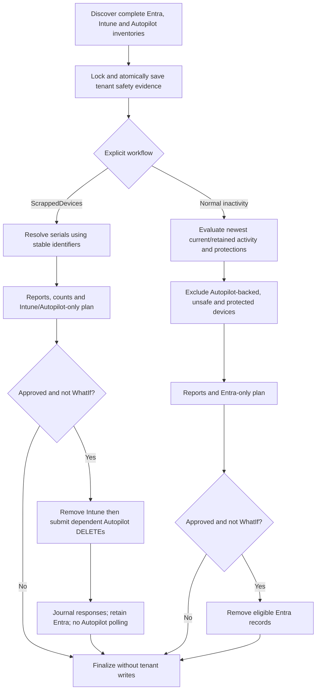

# Architecture

## Two-run lifecycle

The later normal run is an independent invocation with fresh discovery,
classification and approval. It never inherits permission to delete from a
scrapped list or historical plan. Resume selectors are rejected before Graph
connection; their former execution helpers have been removed.

## Source layout

Import `src\StaleDeviceCleanup.psd1`, not implementation files individually.

| File | Responsibility |
| --- | --- |
| `Invoke-StaleDeviceCleanup.ps1` | Parameter sets, scopes, discovery, evidence lifecycle, workflow selection, confirmation and finalization |
| `StaleDeviceCleanup.psm1` | Logging, Graph wrappers, normalization, indexed correlation, activity/protection classification, CSV/JSON reports |
| `DeviceDeletionBatch.ps1` | Immutable plans, workflow/resource enforcement, Intune-to-Autopilot prerequisites, ShouldProcess, context checks, bounded transient retries and journals |
| `DeviceCleanupEvidence.ps1` | Streaming final-journal reader; tenant-scoped evidence locking, validation, conservative merge and atomic persistence |

Discovery functions never delete. Business decisions remain independently
testable with structured objects and offline mocks.

## Durable evidence

`-EvidencePath` is stable across runs and independent of `-OutputPath`.
The default is repository-relative `.state`. Tenant filenames are SHA-256
derived from the tenant ID; the JSON also binds its tenant and schema.

The exclusive lock is held from evidence loading through execution. Its
persistent initialization marker detects a missing initialized JSON file.
Writes use a flushed temporary file and atomic replacement before any DELETE.
Corruption, lock contention or save failure stops writes. Back up the entire
directory; deleting all state is indistinguishable from first installation.

Evidence binds Entra object ID and device ID, retains serial associations,
and merges activity using the maximum timestamp. Missing previously observed
Intune activity and ambiguous/changed identities remain unresolved; they are
not silently cleared by later absence. Retained serials support protection
checks and detection of current re-registration; they are not deletion keys.
Evidence does not authorize or queue deletion.

## Execution and performance

Inventories and indexes are built once. Scrapped correlation logs progress
every 100 serials; reports and plan creation have separate boundary events.
Action reporting indexes correlation rows by resource/object ID.

Destructive batches contain at most 20 requests and execute in service phases.
Scrapped plans cannot contain Entra operations, including when a caller
supplies a separately constructed hash-valid plan. Stale plans permit Entra
only. Plans expire after 30 minutes; no timestamp renewal is performed.

Intent precedes submission, response persistence precedes optional read-back,
and v2 journals use changed-operation events plus full initial/final
checkpoints. Recovery streams to the final checkpoint and rejects incomplete
records. A final checkpoint means execution ended, not every action succeeded.
Legacy full final checkpoints remain readable for investigation.

Autopilot deregistration is asynchronous. Neither batching nor `dependsOn`
proves that deregistration completed. This design deliberately does not wait:
the next normal run protects devices still associated with Autopilot.
See [BatchDeletion.md](BatchDeletion.md) and [DecisionLogic.md](DecisionLogic.md).
